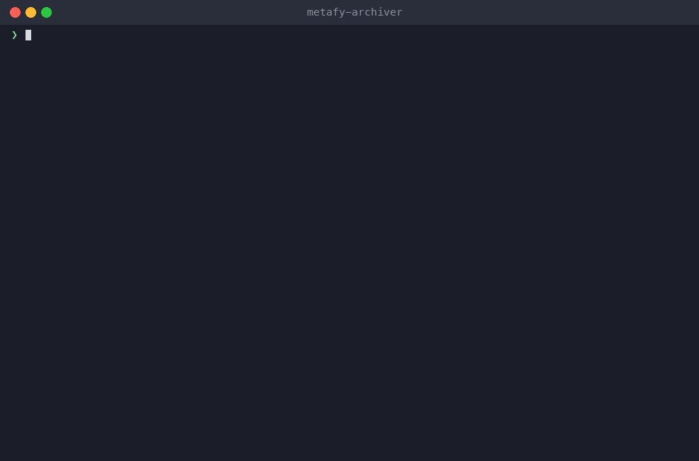
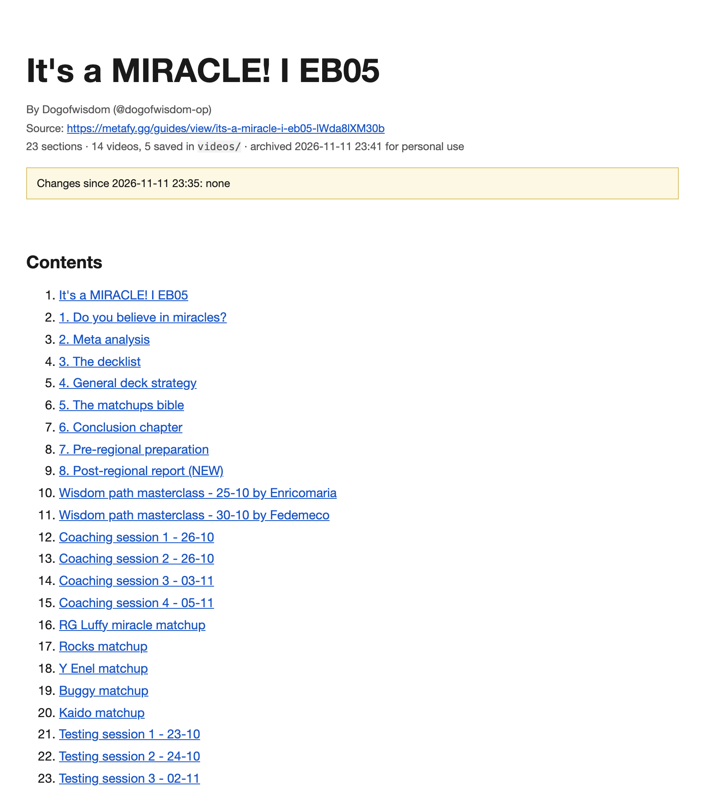
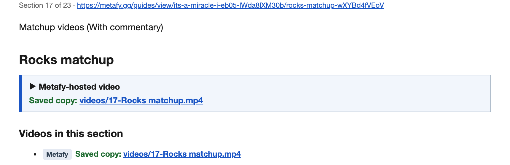

[](https://www.python.org/downloads/)
[](#installing)
[](LICENSE)
<!-- Once this repo is on GitHub, add the test badge:
[](https://github.com/OWNER/metafy-archiver/actions/workflows/test.yml) -->

metafy-archiver keeps offline copies of the [Metafy](https://metafy.gg) guides you have paid for:
one PDF per guide with every section and image, and the Metafy-hosted videos saved alongside as
MP4. It drives a real browser with your own Metafy login, so it only ever sees what you can see,
and everything stays in a `guides/` folder on your computer.



## Table of Contents

- [What you get](#what-you-get)
- [Prerequisites](#prerequisites)
- [Installing](#installing)
  - [macOS and Linux](#macos-and-linux)
  - [Windows](#windows)
  - [By hand](#by-hand)
- [Usage](#usage)
  - [One guide](#one-guide)
  - [Your whole library](#your-whole-library)
  - [Running again](#running-again)
- [Configuration](#configuration)
  - [Videos](#videos)
  - [Look](#look)
  - [Images and PDF size](#images-and-pdf-size)
  - [All options](#all-options)
- [Troubleshooting](#troubleshooting)
- [How it works](#how-it-works)
- [Development](#development)
- [Security and privacy](#security-and-privacy)
- [License](#license)

## What you get

For each guide, a folder `guides/<guide title>/`:

| File | What it is |
| --- | --- |
| `<guide title> - 2026-11-11 2335.pdf` | The whole guide as one PDF in Metafy's dark look (or `--theme light`): cover, table of contents, every section, images, and a video list per section. Each run adds a new timestamped PDF and keeps the old one. |
| `videos/` | Metafy-hosted videos as MP4 (matchup videos, coaching recordings and so on). YouTube, Vimeo and Twitch videos are never downloaded; the PDF links to them. |
| `guide.html` | The same content as a web page. |
| `images/` | Every image, downscaled so the PDF stays a sensible size. |
| `videos.md` | Every video link, grouped by section, with where it is hosted and whether a copy was saved. |
| `source.json` | Titles, section URLs, author and video details as data. |

<p align="center">
  
</p>

Every video in the PDF is labelled with its host, and a downloaded one shows the saved file:

<p align="center">
  
</p>

Running the archiver again on a guide tells you what changed since last time: new, updated or
removed sections are listed on the cover page and flagged in the table of contents.

## Prerequisites

- **Python 3.10 or newer.** Check with `python3 --version` (macOS/Linux) or `py --version`
  (Windows). If it is missing, install it from [python.org](https://www.python.org/downloads/).
- **A Metafy account** with purchased guides. The archiver logs in through a browser window
  exactly as you would; it never asks for your password.
- About **1 GB of free disk** per guide with videos. A guide without videos is around 15 MB.

Everything else (the browser, ffmpeg for videos, image tooling) is installed by the setup script
into a private folder inside the project. Nothing is installed system-wide.

## Installing

Download the project (the green **Code** button on GitHub, then **Download ZIP** and unzip it,
or `git clone`), open a terminal in the project folder, and run the setup once.

### macOS and Linux

```sh
./setup.sh
```

### Windows

In PowerShell:

```powershell
.\setup.ps1
```

> [!NOTE]
> The Windows script follows the same steps as the macOS one but has not yet been exercised on a
> Windows machine. If it misbehaves, use the manual steps below and run `archive.cmd` instead of
> `./archive`.

### By hand

The scripts only do this:

```sh
python3 -m venv .venv
.venv/bin/pip install -r requirements.txt
.venv/bin/python -m playwright install chromium
```

On Windows the paths are `.venv\Scripts\pip` and `.venv\Scripts\python`.

## Usage

### One guide

Any URL of the guide works, including a link to one of its sections:

```sh
./archive "https://metafy.gg/guides/view/its-a-miracle-i-eb05-lWda8lXM30b"
```

A browser window opens. The first time, log in to Metafy there and press Enter in the terminal.
The archiver walks every section, downloads images and Metafy-hosted videos, and writes the PDF.
A 20-section guide with five videos takes about three minutes; later runs reuse the videos.

On Windows use `.\archive` in place of `./archive`.

### Your whole library

```sh
./archive
```

The browser opens on your purchased-guides page. Log in if needed, press Enter, and every guide
you own is archived. "Load more" buttons are clicked for you, and guides already done are skipped.

> [!TIP]
> Use `--match REGEX` to limit library mode to guides whose URL matches, for example
> `./archive --match enel`.

### Running again

Guides already archived are skipped. Pass `--force` to archive one again: you get a fresh
timestamped PDF, the earlier PDF stays, saved videos are reused rather than downloaded, and the
cover reports what changed.

## Configuration

Everything is a command-line option; there is no config file. `./archive --help` lists them.

### Videos

Metafy serves its videos as signed streams that expire within hours, which is why the archiver
saves them during the run. They are kept exactly as served, up to 720p.

| Option | Effect |
| --- | --- |
| `--no-videos` | keep Metafy-hosted videos as links only |
| `--video-max-height 480` | take the smaller 480p variant instead; no re-encoding, instant |
| `--compress-videos` | re-encode to at most 30 fps with x264; roughly a third smaller, costs about a tenth of the video's length in CPU time. Videos you already have are re-encoded from the local copy. |

On one 8-minute 720p60 video the saved file was 47 MB; `--compress-videos` brought it to 31 MB in
ten seconds on a recent Mac.

> [!NOTE]
> YouTube, Vimeo and Twitch videos are never downloaded, by design. They are stable links and
> the PDF points at them.

### Look

PDFs use a dark theme in Metafy's own colours by default, which is what the guides look like on
the site and is easier on the eyes on a screen. `--theme light` gives plain black-on-white pages
for printing. Images with transparent edges are flattened onto whichever page colour is in use.

### Images and PDF size

Images are downscaled to 1600 px on the long side and re-encoded as JPEG, which turns a 100 MB
PDF into a 15 MB one with no visible difference on paper. `--max-image-px 0` keeps the originals.

### All options

| Option | Effect |
| --- | --- |
| `--force` | re-archive guides that were already done |
| `--match REGEX` | library mode: only guides whose URL matches |
| `--no-videos` | keep Metafy-hosted videos as links only |
| `--video-max-height PX` | stream variant to take, default 720 |
| `--compress-videos` | re-encode videos to at most 30 fps and the height above |
| `--max-image-px N` | image size limit, default 1600; `0` keeps originals |
| `--theme light` | plain paper look instead of the default dark Metafy theme |
| `--paper A4` | PDF paper size (default Letter) |
| `-o DIR` | output folder (default `guides/`) |
| `--zip` | after each guide, also pack its folder into `guides/<title>.zip` for moving or sharing with yourself |
| `--login` | log in again even though a session is saved |
| `--browser chromium` | use the bundled Chromium instead of your installed Google Chrome |
| `--headless` | no browser window; only once you are logged in |
| `--delay SECONDS` | pause between pages, default 1.5 |
| `--max-pages N` | stop after N sections of one guide, default 300 |
| `--selector CSS` | if the wrong part of the page is captured |
| `--ffmpeg PATH` | use a specific ffmpeg |

## Troubleshooting

| Symptom | What to do |
| --- | --- |
| Google sign-in refuses to work in the opened window | Google sometimes blocks automated browsers. Log in with email and password or Discord instead. |
| "No guide links found" in library mode | Pass guide URLs directly. The run writes `guides/library-debug.html`; share it if you want library mode fixed. |
| A section comes out nearly empty | The run prints a warning. Usually the login expired: run again with `--login`. |
| Videos are kept as links only | The run says ffmpeg was not found. Re-run `./setup.sh`, or install ffmpeg yourself (`brew install ffmpeg` on a Mac). |
| The wrong part of the page is captured | Pass `--selector` with a CSS selector for the guide body, for example `--selector article`. |
| `./setup.sh: Permission denied` | Run `bash setup.sh` instead; it restores the permissions. |
| Linux: Chromium fails to start with "missing dependencies" | Run `.venv/bin/python -m playwright install-deps chromium` once (needs sudo), then try again. |
| Google Chrome is not installed | Nothing to do; the bundled Chromium is used automatically. |
| Odd characters in the terminal on Windows | Cosmetic. Use Windows Terminal, or ignore it; files are unaffected. |
| Start over | Delete `.browser-profile/` (saved login) and `.state.json` (what is done). |

## How it works

```
 your Chrome profile ──► visit each section ──► js/extract.js cleans the page
        (login)                │                        │
                               │                 images/  videos/ (ffmpeg, while the
                               │                 (parallel, deduplicated, downscaled)   stream links are valid)
                               ▼
                         guide.html ──► clean headless Chromium ──► <title> - <time>.pdf
```

- `metafy_archiver.py` opens a persistent Chrome profile so your login is remembered, finds the
  guide's sections from its sidebar, and visits each one.
- `js/extract.js` runs inside the page: it drops app chrome, keeps the content and images, turns
  video players into labelled boxes and reads the Mux player's signed stream link.
- `mfa_media.py` downloads images in parallel and deduplicates them by content, shrinks them,
  and saves Metafy-hosted streams with ffmpeg.
- `mfa_output.py` writes `guide.html`, `videos.md` and `source.json`, then a separate clean
  headless Chromium renders the PDF so no session data can leak into it.

Metafy's page structure can change. If an archive looks wrong after a site redesign, the
heuristics in `js/extract.js` are where to look.

## Development

```sh
.venv/bin/python tests/test_images.py   # image shrinking rules, a second
.venv/bin/python tests/test_mock.py     # the whole pipeline against tests/fixture/, ten seconds
.venv/bin/ruff check .                  # lint (pip install ruff)
```

The mock test serves a small fake guide site, archives it twice (the second time with a section
inserted and one edited), really downloads a clip with ffmpeg, and re-encodes it. A GitHub
Actions workflow in `.github/workflows/test.yml` runs the same on every push.

`docs/demo.gif` is rendered from a real, path-sanitised run by `docs/demo/render.py`.

## Security and privacy

- Your Metafy login lives only in `.browser-profile/` on your machine. It is never written into
  the archive; the PDF is rendered by a separate browser with no session at all.
- The archiver sends requests only to Metafy and its media hosts, with the same cookies your
  browser would send them.
- Signed stream links recorded in `source.json` are short-lived playback tokens, not account
  credentials.

This is for personal backups of content you have bought. Don't redistribute the output; the
coaches who write these guides are paid per sale.

## License

[MIT](LICENSE).
